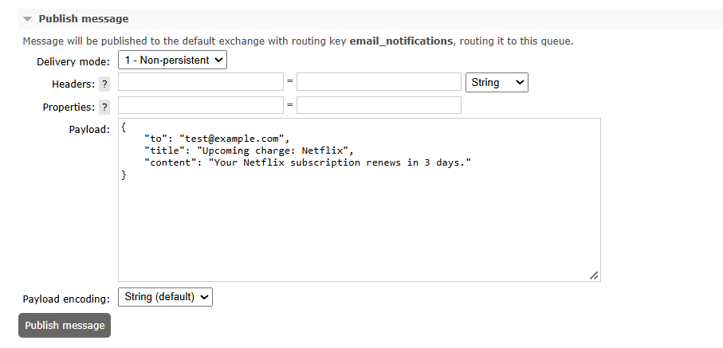
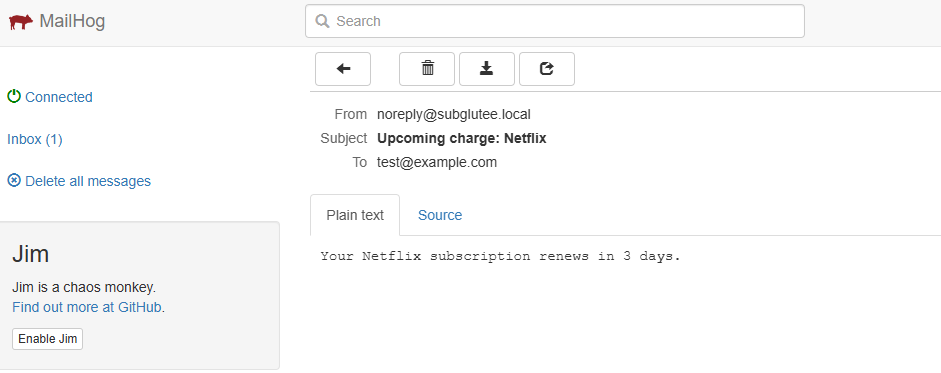
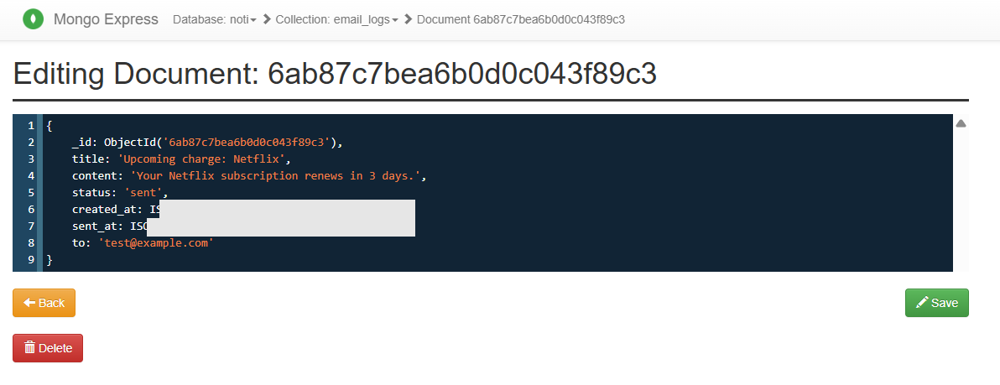

# Subglutee Project - Notification Service

worker consume message จาก RabbitMQ แล้วบันทึก in-app notification + ส่งอีเมลผ่าน SMTP, log ผลลง Mongo และเปิด REST ให้ frontend ดึง/อ่าน/ลบ in-app notification

### Message contract

producer (เช่น sgt-scheduler) publish JSON ไป queue `email_notifications`:

```json
{
  "reminder_id": "1dfaf720-2db1-4ef4-9a08-9c69e339e7a0:billing:2026-10-31",
  "user_id": "11111111-1111-4111-8111-111111111111",
  "subscription_id": "1dfaf720-2db1-4ef4-9a08-9c69e339e7a0",
  "to": "test@example.com",
  "title": "Upcoming charge: Netflix",
  "content": "Your Netflix subscription renews in 3 days.",
  "inapp_title": "Netflix",
  "inapp_content": "Next Payment Upcoming, 31 October 2026"
}
```

| Field             | JSON type | Meaning                                                                            |
| ----------------- | --------- | ---------------------------------------------------------------------------------- |
| `reminder_id`     | string    | optional - id ของการเตือน 1 ครั้ง (`<subscription_id>:<kind>:<date>`) ใช้กันส่งซ้ำ |
| `user_id`         | string    | optional - เจ้าของ in-app notification                                             |
| `subscription_id` | string    | optional - subscription ที่ถูกเตือน                                                |
| `to`              | string    | Email ผู้รับ                                                                       |
| `title`           | string    | หัวข้อ email ที่ producer จัดเตรียมแล้ว                                            |
| `content`         | string    | เนื้อหา plain-text email ที่ producer จัดเตรียมแล้ว                                |
| `inapp_title`     | string    | optional - หัวข้อ in-app (ไม่เกิน 100 ตัวอักษร)                                    |
| `inapp_content`   | string    | optional - เนื้อหา in-app (ไม่เกิน 300 ตัวอักษร)                                   |

สร้าง in-app notification เฉพาะ message ที่มี `reminder_id`, `user_id`, `subscription_id`, `inapp_title`, `inapp_content` ครบ ถ้าไม่ครบจะส่งแค่ email (log `skip in-app notification: missing ...`)

### Dedupe

ถ้า message มี `reminder_id` และใน `email_logs` มี record ที่ `reminder_id` เดียวกันและ `status = sent` แล้ว จะ Ack ทิ้งโดยไม่ส่งซ้ำทั้ง email และ in-app (log `skip already-sent reminder_id=...`)

- กัน RabbitMQ redeliver และ scheduler publish ซ้ำทุกวันที่ยังอยู่ในช่วงเตือน (ADR-005)
- in-app ที่ user ลบไปแล้ว (hard delete) จะไม่ถูกสร้างใหม่ เพราะ email ของ reminder นั้นส่งไปแล้ว
- message ที่ไม่มี `reminder_id` (เช่น publish ทดสอบจาก UI) ส่งทุกครั้งเหมือนเดิม
- ถ้าส่งไม่สำเร็จ (`failed`) message ถัดไปที่ id เดิมยังลองส่งได้

Notification Service ไม่จำเป็นต้องรู้ schema ของ user หรือ subscription โดยตรง โดย producer เป็นผู้เตรียมข้อมูลสำหรับ email ก่อน publish message เข้า RabbitMQ

### Notification log

หลังจากประมวลผล email แล้ว Notification Service บันทึกผลลง MongoDB collection `email_logs`

| Field         | Meaning                                                                   |
| ------------- | ------------------------------------------------------------------------- |
| `_id`         | ID ที่ MongoDB สร้างให้โดยอัตโนมัติ                                       |
| `reminder_id` | id ของการเตือนจาก message (ว่างถ้า message ไม่มี) - index คู่กับ `status` |
| `to`          | Email ผู้รับ                                                              |
| `title`       | หัวข้อ email                                                              |
| `status`      | สถานะการส่ง เช่น `sent` หรือ `failed`                                     |
| `created_at`  | เวลาที่สร้าง notification log                                             |
| `sent_at`     | เวลาที่ส่ง email สำเร็จ หรือ `null` หากส่งไม่สำเร็จ                       |

### In-app notification

consumer บันทึก in-app ก่อนส่ง email ลง collection `in_app_notifications` ถ้าบันทึกไม่สำเร็จจะ Nack requeue (ยังไม่ส่ง email รอบนั้น) และ retry ไม่สร้างซ้ำเพราะ upsert ด้วย `reminder_id`

| Field             | Meaning                                                            |
| ----------------- | ------------------------------------------------------------------ |
| `_id`             | ID ที่ MongoDB สร้างให้                                            |
| `reminder_id`     | id ของการเตือน - unique index (partial: เฉพาะ doc ที่มี field นี้) |
| `user_id`         | เจ้าของ notification                                               |
| `subscription_id` | subscription ที่ถูกเตือน                                           |
| `title`           | `inapp_title` จาก message                                          |
| `content`         | `inapp_content` จาก message                                        |
| `status`          | `true` เมื่อบันทึกสำเร็จ                                           |
| `read_status`     | `false` ตอนสร้าง, `true` หลัง user เปิดหน้า Notification          |
| `created_at`      | เวลาที่สร้าง - index คู่กับ `user_id`                              |
| `sent_at`         | เวลาที่บันทึกสำเร็จ                                                |

REST (ต้องมี `Authorization: Bearer <access token>` ที่เซ็นด้วย `JWT_SECRET` เดียวกับ auth-service, ไม่มีหรือผิด = 401) ผ่าน gateway เรียกที่ `/api/v1/notifications` (gateway ตัด `/api/v1` ออกก่อนส่งต่อ):

| Method   | Path                          | Response                                                          |
| -------- | ----------------------------- | ----------------------------------------------------------------- |
| `GET`    | `/notifications`              | `200` array ของ notification ของ user ที่ login อยู่ ใหม่สุดก่อน |
| `GET`    | `/notifications/unread-count` | `200 {"unread_count": n}` จำนวนที่ `read_status = false`          |
| `PATCH`  | `/notifications/read`         | `200 {"updated_count": n}` ตั้งทุกรายการของ user เป็นอ่านแล้ว     |
| `DELETE` | `/notifications/:id`          | `204`, `400` id ผิดรูปแบบ, `404` ไม่เจอหรือไม่ใช่ของ user        |
| `DELETE` | `/notifications`              | `200 {"deleted_count": n}` ลบทั้งหมดของ user ที่ login อยู่      |

Known gap:

- ลบ in-app ไปแล้ว แต่ email ของ reminder นั้นยังส่งไม่สำเร็จ (กำลัง retry) -> รอบ retry จะสร้าง in-app ใหม่
- ลบบัญชี user แล้ว in-app ของ user นั้นยังค้างอยู่ (ยังไม่มี API ให้ user-service สั่งลบ)

### Structure

```text
consumer/       RabbitMQ consumer, decode message -> บันทึก in-app -> ส่ง email
usecases/       EmailNotificationUsecase (email + log, dedupe), InAppNotificationUsecase (record/list/read/delete)
mailer/         SMTP adapter
repositories/   Mongo adapter: email_logs, in_app_notifications
models/         EmailNotification, InAppNotification struct
dtos/           EmailMessage queue message, in-app REST response
controllers/    GET /health, in-app notification list/unread-count/read/delete
middlewares/    RequireAuth (JWT HS256, ตั้ง user_id จาก sub)
routes/         /health, /notifications
config/         env loader + MongoDB/RabbitMQ connection
```

flow: `consumer -> usecases -> repositories (in-app) + mailer (ส่งเมล) + repositories (log ผล)`
REST: `routes -> middlewares (JWT) -> controllers -> usecases -> repositories`

### Prerequisite

- Go 1.26
- Docker + Docker Compose
- `make` - `winget install ezwinports.make`
- tools:

```terminal
go install github.com/golangci/golangci-lint/v2/cmd/golangci-lint@latest
go install github.com/evilmartians/lefthook@latest
lefthook install
```

### Setup

```terminal
git clone https://github.com/polar-bear-cu/sgt-noti-service.git
cd sgt-noti-service
lefthook install
cp .env.example .env
go mod download
make compose-up
make run
```

### Run alternatively (container)

```terminal
make image
make container
```

### Useful Commands

Check `Makefile`

### Dev tools

- MailHog UI: `localhost:8025` - ดูเมลที่ส่งออก
- RabbitMQ management UI: `localhost:15672` (guest/guest) - ดูคิว
- mongo-express: `localhost:8089` - ดู log

### Email flow test

1. Restart Go service หลังเปลี่ยน DTO: `Ctrl+C` แล้ว `go run .`
2. เปิด `http://localhost:8088/health` และตรวจ `status: ok`
3. เปิด RabbitMQ Management → Queues and Streams → `email_notifications` → Publish message
4. Publish JSON ตาม message contract ด้านบน
5. เปิด MailHog แล้วตรวจว่า email subject ตรงกับ `title`, body ตรงกับ `content` และผู้รับถูกต้อง
6. เปิด Mongo Express → database `noti` → collection `email_logs`
7. ตรวจ record ว่ามี `to`, `title`, `content`, `status`, `created_at`, `sent_at` ตรงตามที่ service ประมวลผล

ตัวอย่างการ Publish JSON:



ตัวอย่างผลลัพธ์ใน MailHog:



ตัวอย่างผลลัพธ์ใน Mongo Express:


